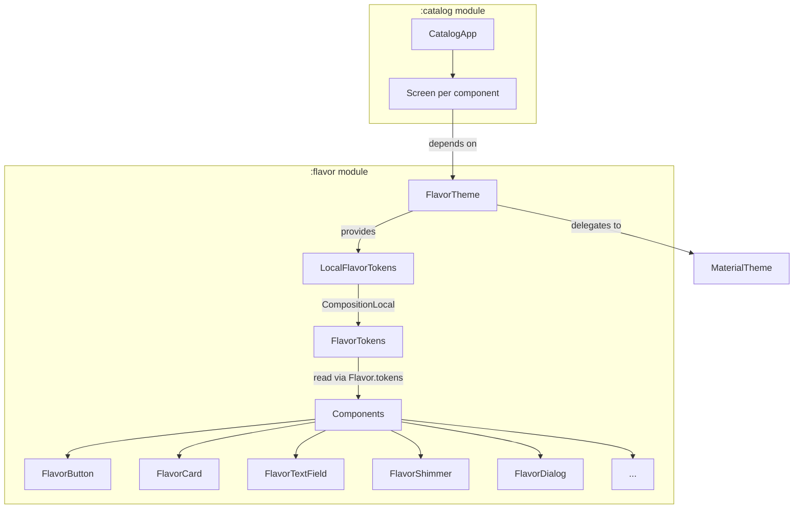

# Flavor: Android Design System

[](https://github.com/hendra-marihot/android-design-system/actions/workflows/ci.yml)
[](LICENSE)

A Jetpack Compose component library built on a token layer, plus a catalog app that exercises every component. It shows how I build a UI layer that stays consistent as a team and a product grow.

I ship on both Flutter and native Android. I built this one in Compose because the problems are the same in any toolkit: token management, API consistency and theming contracts.


## Why a design system

Codebases without one show the same symptoms: hardcoded colors that break in dark mode, spacing that drifts from screen to screen, loading states that look different on every page, and no shared vocabulary between design and engineering. New screens get copied from old ones, and bugs come along.

This library covers the parts that matter most: a token layer for design decisions, components with enforced API rules, and a catalog that proves the pieces work together.

## Key decisions

### A token layer on top of Material 3

Material 3 already provides color, typography and shape. `FlavorTokens`, an `@Immutable data class` delivered through a `CompositionLocal`, adds spacing, radius, elevation and icon sizes. Those are the values Material leaves open, and the ones that drift when every developer picks their own.

The cost is indirection. Components read `Flavor.tokens.spacingMd` instead of writing `16.dp`. The payoff comes when a second brand or a design refresh changes the scale: you change one place. `FlavorTheme(tokens = ...)` accepts overrides, so per-tenant theming is a constructor call.

Color and typography tokens are left out on purpose. Material 3's `colorScheme` and `typography` handle them well.

### API rules as enforcement

Every composable follows the same contract:

- `modifier: Modifier = Modifier` is the first optional parameter
- No hardcoded colors. Everything goes through `MaterialTheme.colorScheme`
- No raw `Dp` literals for spacing, radius or elevation. Everything goes through `Flavor.tokens`
- No `android.*` imports except `Configuration` for previews
- Light and dark `@Preview` on every component

The rules matter more than any single component. A design system that breaks its own conventions teaches the wrong habits.

### Library and catalog as separate modules

`:catalog` depends on `:flavor` through `implementation(project(":flavor"))`, so it can only use the public API. If a demo screen cannot be built without reaching into internals, the API needs work. The catalog uses type-safe navigation with `@Serializable` routes, so it is a real app rather than a throwaway.

## Architecture



`FlavorTheme` wraps `MaterialTheme` and provides the token `CompositionLocal`. Components read tokens through `Flavor.tokens`. Consumers override tokens at the theme level without touching component code.

## Components

| Component | Wraps | Notable |
|---|---|---|
| `FlavorButton` | Button, FilledTonalButton, OutlinedButton, TextButton | 5 variants via enum. Loading state disables the button and shows a spinner |
| `FlavorCard` | Card, OutlinedCard | 3 styles. Optional `onClick` switches between clickable and static |
| `FlavorTextField` | OutlinedTextField | Trailing icon with optional click handler. Error state with supporting text |
| `FlavorDialog` | AlertDialog | Destructive mode colors the confirm button with `error` |
| `FlavorBottomSheet` | ModalBottomSheet | Exposes `SheetState` to the caller |
| `FlavorShimmer` | custom | Animated gradient sweep. Colors adapt to light and dark |
| `FlavorCardSkeleton` | FlavorShimmer | Image, title and subtitle layout |
| `FlavorListItemSkeleton` | FlavorShimmer | Avatar and two text lines |
| `FlavorEmptyView` | custom | Full-screen empty state. Reuses `FlavorButton` for the action |
| `FlavorErrorView` | custom | Full-screen error state with optional retry |

Each component has a Compose UI test in `androidTest` and a catalog screen. `FlavorTokensTest` covers the token defaults on the JVM.

## Out of scope

- **Typography and color tokens.** Material 3 covers them.
- **Drawers, tabs, chips, snackbars, top bars.** The set covers distinct interaction types: input, action, feedback, loading, overlay. Ten consistent components show the system better than forty loose ones.
- **Compose Multiplatform.** Android only. A cross-platform design system is a different project.
- **A theme picker UI.** The token system supports it. Building the picker is catalog polish.

## What I would change

- **Add screenshot tests.** The UI tests check behavior, not pixels. Roborazzi or Paparazzi would catch visual regressions.
- **Add accessibility tests.** Components inherit Material semantics, but content descriptions, touch targets and screen reader behavior are not tested.
- **Tokenize the skeletons.** `FlavorCardSkeleton` and `FlavorListItemSkeleton` still use a few raw `Dp` values such as `160.dp` and `48.dp`.
- **Enable Compose stability reports.** `FlavorTokens` is `@Immutable`, but the compiler report would confirm every component is skippable.

## Stack

- Kotlin 2.4.21, Compose BOM 2026.09.00, Material 3
- Gradle 9.7 and AGP 9.3 with built-in Kotlin
- `compileSdk 37`, `minSdk 26`, JDK 17 toolchain
- Navigation Compose 2.10 with `@Serializable` routes
- GitHub Actions CI: builds both modules, runs tests and lint on every push and PR
- Maven Central publishing through the Central Portal: a `v*` tag signs and uploads the AAR
- Version catalog (`libs.versions.toml`) for every dependency

## Build

Needs a JDK 17 or newer to run Gradle and the API 37 platform (`platforms;android-37.0`). If the local JDK is newer than 17, the toolchain resolver downloads JDK 17 for compilation. AGP installs the platform when the SDK licenses are accepted.

```bash
./gradlew :flavor:assembleRelease       # library AAR
./gradlew :catalog:assembleDebug        # catalog APK
./gradlew test lint                     # unit tests and lint
./gradlew connectedAndroidTest          # Compose UI tests, needs an emulator
```

## Publishing

Coordinates: `io.github.hendra-marihot:flavor`. The version is `flavor` in `gradle/libs.versions.toml`.

Pushing a tag `vX.Y.Z` runs the [publish workflow](.github/workflows/publish.yml). A `verify` job checks that the tag matches the catalog version and points at a commit on `main`, then runs the library tests and lint. A `publish` job then signs the release AAR, its sources jar and an empty javadoc jar, which Central requires, and uploads them to Maven Central through the Central Portal. OSSRH, the old staging host, shut down in June 2025.

The `publish` job runs in the `maven-central` environment, so the four secrets can live there: `MAVEN_CENTRAL_USERNAME` and `MAVEN_CENTRAL_PASSWORD` from a Central Portal user token, `SIGNING_KEY` as an ASCII-armored private GPG key, and `SIGNING_KEY_PASSWORD`. Adding a required reviewer to the environment turns every release into a manual approval. The `io.github.hendra-marihot` namespace is verified through the GitHub account on the portal.

To inspect the artifacts without publishing:

```bash
./gradlew :flavor:publishToMavenLocal   # writes to ~/.m2/repository/io/github/hendra-marihot/flavor
```

## Related repositories

Each repo in this set covers one area of mobile engineering.

| Repository | Focus |
|---|---|
| [compose-newsreader](https://github.com/hendra-marihot/compose-newsreader) | Multi-module Android, Hilt, Room, offline-first |
| **android-design-system** (this repo) | Compose component library, design tokens |
| [compose-performance-lab](https://github.com/hendra-marihot/compose-performance-lab) | Compose performance anti-patterns and fixes |
| [kmp-currency-converter](https://github.com/hendra-marihot/kmp-currency-converter) | Kotlin Multiplatform, shared business logic |
| [flutter-expense-tracker](https://github.com/hendra-marihot/flutter-expense-tracker) | Clean Architecture, Riverpod, Drift, Material 3 |
| [flutter-ui-toolkit](https://github.com/hendra-marihot/flutter-ui-toolkit) | Reusable widgets, shimmer, adaptive layouts |
| [flutter-platform-bridge](https://github.com/hendra-marihot/flutter-platform-bridge) | Platform channels, native interop |
| [mobile-ci-cd-templates](https://github.com/hendra-marihot/mobile-ci-cd-templates) | CI/CD, release automation |

## License

Copyright 2026 Hendra Marihot. Licensed under the [Apache License 2.0](LICENSE).
